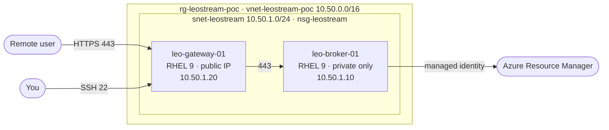

# Leostream Platform 26 on Azure — Proof of Concept

PowerShell automation for the smallest useful **Leostream Platform 26** proof of
concept on Microsoft Azure: **two virtual machines in one subnet.** A private
Connection Broker and a separate internet-facing Leostream Gateway. Nothing else.

> **No secrets, installers or licence material live in this repository.**
> Linux access is SSH-key only, the Broker uses a system-assigned managed
> identity, and Leostream media is downloaded at run time from URLs you supply.

---

## Contents

- [Architecture](#architecture)
- [Repository layout](#repository-layout)
- [Prerequisites](#prerequisites)
- [Quick start](#quick-start)
- [Configuration](#configuration)
- [Deployment](#deployment)
- [Administrative access](#administrative-access)
- [Leostream configuration](#leostream-configuration)
- [Validation](#validation)
- [Troubleshooting](#troubleshooting)
- [Teardown](#teardown)
- [Cost](#cost)
- [Security notes](#security-notes)
- [Licence](#licence)

---

## Architecture



| Component | Resource | OS | Exposure |
|---|---|---|---|
| Connection Broker | `leo-broker-01` | RHEL 9 | Private only, system-assigned managed identity |
| Gateway | `leo-gateway-01` | RHEL 9 | Public IP: TCP/443 for users, TCP/22 for you |

Everything sits in one subnet, `snet-leostream` (`10.50.1.0/24`), protected by one
network security group, `nsg-leostream`, with exactly two inbound rules — 443 and
22, both restricted to `AllowedClientCidrs`. Azure's built-in rules already allow
Gateway-to-Broker traffic inside the VNet and deny everything else from the
internet, so no further rules are needed.

Broker and Gateway are **always separate virtual machines** — the deployment and
validation scripts both enforce this.

**No desktops are deployed.** This PoC covers the Leostream control plane only.
That means the end-to-end user session, Agent registration, pools, policies and
the Broker starting/stopping a desktop VM are not exercised out of the box. The
Broker's managed identity *is* deployed and verified, but it is intentionally
left with no role assignment, since there is nothing for it to manage. To go
further, see [Adding an Azure Center later](#adding-an-azure-center-later).

**No Azure Bastion.** You administer over SSH to the Gateway's public IP and hop
to the Broker from there. See [Administrative access](#administrative-access).

Full detail: [docs/architecture.md](docs/architecture.md).

---

## Repository layout

```
leostream-azure-poc/
├── README.md
├── LICENSE
├── .gitignore
├── config/
│   └── poc.config.psd1              # single source of truth, no secrets
├── docs/
│   ├── architecture.md              # design, topology, traffic flows
│   ├── installation.md              # step-by-step deployment guide
│   └── validation.md                # acceptance checks and negative tests
└── scripts/
    ├── Deploy-LeostreamPoC.ps1          # RG, VNet, 1 subnet, 1 NSG, 2 VMs
    ├── Install-LeostreamBroker.ps1      # Platform 26 on leo-broker-01
    ├── Install-LeostreamGateway.ps1     # Gateway on leo-gateway-01
    ├── Test-LeostreamPoC.ps1            # validation
    └── Remove-LeostreamPoC.ps1          # teardown
```

---

## Prerequisites

| Requirement | Minimum |
|---|---|
| PowerShell | Windows PowerShell **5.1** or PowerShell **7.4+** (7.x recommended) |
| Az modules | `Az.Accounts`, `Az.Resources`, `Az.Network`, `Az.Compute` (11.0+) |
| Azure permissions | **Contributor** on the subscription or resource group. User Access Administrator is *not* needed — no role assignments are created |
| Azure quota | ~6 vCPUs of the `Dsv5` family in the target region |
| SSH key pair | For the two RHEL 9 VMs |
| Leostream | An evaluation licence. The installer packages download automatically from the public URLs in `poc.config.psd1` |

```powershell
Install-Module Az -Scope CurrentUser -Repository PSGallery -Force
```

For the SSH key you have two options:

```powershell
# Option A - reuse your existing default key. Nothing else to change;
# poc.config.psd1 already points at ~/.ssh/id_rsa.pub.
Get-ChildItem $HOME\.ssh\id_rsa.pub

# Option B - generate a key dedicated to this PoC...
ssh-keygen -t ed25519 -C "leostream-poc" -f $HOME\.ssh\leostream_poc
# ...and then set this in config/poc.config.psd1 BEFORE deploying:
#   SshPublicKeyPath = '~/.ssh/leostream_poc.pub'
```

Whichever you choose, `Admin.SshPublicKeyPath` in the config must point at the
**public** key (`.pub`), and the matching **private** key is what you pass to
`ssh -i` later. If the two disagree you will deploy one key and authenticate with
another, which fails with `Permission denied (publickey)`.

---

## Quick start

```powershell
git clone https://github.com/mehmetkadriumay/leostream-azure-poc.git
cd leostream-azure-poc

# 1. Edit config/poc.config.psd1 - at minimum set AllowedClientCidrs and SshPublicKeyPath
code config/poc.config.psd1

# 2. Sign in. -Tenant matters if your account is in more than one directory
Connect-AzAccount -Tenant '<tenant-id>'
Set-AzContext -Subscription '<subscription-id>'

cd scripts

# 3. Preview, then deploy the infrastructure (about 5 minutes)
./Deploy-LeostreamPoC.ps1 -WhatIf
./Deploy-LeostreamPoC.ps1 -Verbose

# 4. Install the Leostream software. Versions come from poc.config.psd1;
#    override with -InstallerUri to test a different build.
./Install-LeostreamBroker.ps1
./Install-LeostreamGateway.ps1

# 5. Validate
./Test-LeostreamPoC.ps1
```

---

## Configuration

Everything is centralised in [`config/poc.config.psd1`](config/poc.config.psd1).

| Key | Default | Change this when |
|---|---|---|
| `Azure.SubscriptionId` | `''` (current context) | Targeting a specific subscription |
| `Azure.Location` | `westeurope` | Different region |
| `Azure.ResourceGroupName` | `rg-leostream-poc` | Naming standards differ |
| `Network.AddressSpace` | `10.50.0.0/16` | Overlaps existing networks |
| `Network.SubnetPrefix` | `10.50.1.0/24` | Address plan differs |
| `AllowedClientCidrs` | `0.0.0.0/0` | **Always** — narrow to your egress IP |
| `VirtualMachines.*.Size` | `D4s_v5` / `D2s_v5` | Cost or performance tuning |
| `Admin.SshPublicKeyPath` | `~/.ssh/id_rsa.pub` | Your key lives elsewhere |
| `Leostream.BrokerInstallerUri` | Platform `26.1.6-1` | Testing a different Broker build |
| `Leostream.GatewayInstallerUri` | Gateway `2026.1.1-2` | Testing a different Gateway build |

The deployment script prints a warning if `AllowedClientCidrs` still contains
`0.0.0.0/0`. That default leaves SSH open to the internet — change it.

### What is never stored here

* Linux credentials — password auth is disabled, SSH public key only
* Leostream licence keys and serial numbers — passed as a `SecureString` or
  entered in the Broker UI
* Leostream RPMs — never committed; downloaded at run time from the public
  URLs in `poc.config.psd1`, which are version pointers, not credentials
* Azure credentials and service-principal secrets — the Broker uses a
  system-assigned managed identity

---

## Deployment

### 1. Infrastructure — `Deploy-LeostreamPoC.ps1`

Creates, idempotently:

1. Resource group `rg-leostream-poc` with PoC tags
2. One NSG, `nsg-leostream`, allowing inbound 443 and 22 from `AllowedClientCidrs`
3. VNet `vnet-leostream-poc` with one subnet, `snet-leostream`
4. `leo-broker-01` (private, managed identity) and `leo-gateway-01` (public IP)

```powershell
./Deploy-LeostreamPoC.ps1 -WhatIf     # preview
./Deploy-LeostreamPoC.ps1 -Verbose
```

Re-running skips anything that already exists. It finishes by printing the
Gateway's public IP and the exact SSH commands for administration.

### 2–3. Software installation

The installers run through the **Azure RunCommand extension**, so the Broker
never needs inbound connectivity from the internet.

| Script | Does |
|---|---|
| `Install-LeostreamBroker.ps1` | Updates RHEL 9, installs prerequisites, opens 443/tcp, sets hostname, enables EPEL, installs Platform 26, optionally applies a licence key |
| `Install-LeostreamGateway.ps1` | Configures firewalld (443 and 22 open, with `nsg-leostream` restricting the source), applies gateway kernel settings, enables EPEL, installs the Gateway, records the Broker address |

Both default to the URLs in `Leostream.*InstallerUri`. Pass `-InstallerUri` to
pin a different build:

```powershell
./Install-LeostreamBroker.ps1 -InstallerUri 'https://downloads.leostream.com/leostream-broker-26.1.6-1.x86_64.rpm'
```

A `.rpm` and a shell installer are both accepted — the script inspects the
downloaded file and either runs it or hands it to `dnf`.

**Why EPEL.** The Leostream packages depend on software Red Hat does not ship
in the Azure RHUI repositories — the Gateway alone needs `libguac`, `openvpn`,
`certbot`, `mod_perl` and `libvncserver`. Both scripts enable EPEL first, which
resolves every dependency. CodeReady Builder is already enabled on the Azure
RHEL 9 image.

Full walkthrough: [docs/installation.md](docs/installation.md).

---

## Administrative access

There is no Bastion and no jump host. The Gateway's public IP is the single way
in, and it only accepts connections from `AllowedClientCidrs`.

### Where to run these commands

**Run everything in this section on your own Windows PC, in PowerShell.** Not in
the Azure portal's Cloud Shell, and not inside either VM.

| Command type | Where it runs | Prompt looks like |
|---|---|---|
| `.ps1` scripts, `Get-Az*`, and every `ssh` command below | Your Windows PC, PowerShell | `PS C:\Users\you\leostream-azure-poc>` |
| `systemctl`, `firewall-cmd`, `dnf` | Inside a VM, after you have SSH'd in | `[leoadmin@leo-gateway-01 ~]$` |

This matters more than it sounds. `-J` and `-L` are instructions to *your local*
SSH client about how to route a connection out of your machine, so they only make
sense there. Your private key also only exists on your PC and should never be
copied to a VM.

Two symptoms that mean you are in the wrong shell:

| Error | What happened |
|---|---|
| `Identity file /home/leoadmin.sshleostream_poc not accessible` | You ran it inside a VM. Bash expanded `$HOME` to the Linux home directory and silently ate the `\` characters in the Windows path. Type `exit` to get back to PowerShell. |
| `ssh: Could not resolve hostname $gw` | You ran it in a bash shell, where PowerShell variables do not exist. |

### Prerequisites on your PC

* **OpenSSH client** — built into Windows 10 1803+ and Windows 11. Check with
  `ssh -V`; you need 7.3 or newer for `-J`. Windows 11 ships 9.x.
* **The private key whose public half you deployed.** This is whatever
  `Admin.SshPublicKeyPath` pointed at when you ran `Deploy-LeostreamPoC.ps1`,
  minus the `.pub` suffix. With the shipped default that is
  `C:\Users\<you>\.ssh\id_rsa`. Step 1 below works it out for you.
* **Your current public IP inside `AllowedClientCidrs`.** If your ISP changed it,
  update the config and re-run `Deploy-LeostreamPoC.ps1` to refresh the NSG.

### Step 1 — set up your variables

Do not hard-code or retype the Gateway address or the key path. Derive both from
the config and from Azure, so they cannot drift apart. Run this from the
repository root:

```powershell
cd C:\path\to\leostream-azure-poc

$cfg  = Import-PowerShellDataFile ./config/poc.config.psd1
$rg   = $cfg.Azure.ResourceGroupName
$user = $cfg.Admin.LinuxUsername

# private key = the configured public key, minus the .pub suffix
$key = ($cfg.Admin.SshPublicKeyPath -replace '^~', $HOME -replace '\.pub$','')
$gw  = (Get-AzPublicIpAddress -ResourceGroupName $rg `
          -Name $cfg.VirtualMachines.Gateway.PublicIpName).IpAddress

# ALWAYS check these before using them
$gw                       # must print an IP address
Test-Path $key            # must print True
```

Both checks matter:

* **`$gw` blank** — the public IP does not exist yet, or you are signed in to the
  wrong subscription. Stop and fix it. An unset variable in PowerShell expands to
  an empty string rather than raising an error, which surfaces later as a
  baffling `Invalid -J argument`.
* **`Test-Path $key` is False** — you are about to pass `ssh -i` a file that does
  not exist, and you will get `Identity file ... not accessible`. The usual cause
  is generating a key under one name while `Admin.SshPublicKeyPath` still points
  at another. The config default is `~/.ssh/id_rsa.pub`, so unless you changed
  it, the private key is `~/.ssh/id_rsa` — **not** `leostream_poc`.

PowerShell variables are **per window**. Open a new terminal and they are all
empty again, so re-run this block each time.

### Step 2 — open a shell on the Gateway

```powershell
ssh -i $key $user@$gw
```

Expect a host-key prompt on first connection; type `yes`. You should land at
`[leoadmin@leo-gateway-01 ~]$` with no password prompt. Type `exit` to return.

If you are using your default key (`~/.ssh/id_rsa`), `-i $key` is optional —
OpenSSH tries that key automatically. It is kept in these examples so they work
whichever key you configured.

Get this working before trying anything below — the other two commands both
depend on it.

### Step 3 — open a shell on the Broker

The Broker has no public IP, so SSH hops through the Gateway in a single command
using `-J` (ProxyJump). Still run this **on your PC**, not on the Gateway:

```powershell
ssh -i $key -J $user@$gw $user@10.50.1.10
```

You should land at `[leoadmin@leo-broker-01 ~]$`. Your key is used twice, for
both hops, and is never copied to the Gateway.

### Step 4 — reach the Broker web UI

The Broker's console is on port 443 of a private address, so forward a local port
through the Gateway with `-L`:

```powershell
ssh -i $key -L 8443:10.50.1.10:443 $user@$gw
```

**Leave that window open** — closing it closes the tunnel. In a browser on the
same PC, go to:

```
https://localhost:8443/
```

Accept the self-signed certificate warning. `-L 8443:10.50.1.10:443` reads as:
listen on port 8443 on this PC, and forward anything arriving there to
`10.50.1.10:443` as seen from the Gateway. Use a different local port if 8443 is
already taken.

### If something fails

| Symptom | Cause | Fix |
|---|---|---|
| `Invalid -J argument` | `$gw` is empty | Re-run step 1 and confirm `$gw` prints an IP |
| `Identity file ... not accessible: No such file or directory` | The key named in `-i` does not exist. Usually you generated `leostream_poc` but left `Admin.SshPublicKeyPath` at the default `~/.ssh/id_rsa.pub`, or the reverse | `Get-ChildItem $HOME\.ssh` to see what you actually have, then make the config and the `-i` path agree. Step 1 derives `$key` correctly |
| Connection hangs, then times out | Your IP is not in `AllowedClientCidrs` | Check with `(Invoke-RestMethod https://api.ipify.org?format=json).ip`, add it to the config, re-run `Deploy-LeostreamPoC.ps1` |
| `Permission denied (publickey)` | You are offering a different key from the one deployed, or the wrong username | Compare them: `(Get-AzVM -ResourceGroupName $rg -Name leo-gateway-01).OSProfile.LinuxConfiguration.Ssh.PublicKeys[0].KeyData` against `Get-Content "$key.pub"` |
| `Identity file ... not accessible` with a mangled path like `/home/leoadmin.sshleostream_poc` | Running in bash inside a VM, not PowerShell. Bash expanded `$HOME` to the Linux home and ate the `\` characters | `exit` back to PowerShell |
| Step 2 works but step 3 hangs | Broker VM is stopped or still booting | `Get-AzVM -ResourceGroupName $rg -Name leo-broker-01 -Status` |
| Browser shows `ERR_CONNECTION_REFUSED` on localhost:8443 | Tunnel window closed, or the Broker software is not installed yet | Reopen the tunnel; check `systemctl status leostream` on the Broker |
| `WARNING: UNPROTECTED PRIVATE KEY FILE` | Key file permissions too open | `icacls $key /inheritance:r /grant:r "$($env:USERNAME):(R)"` |

### Avoiding SSH entirely

If you would rather not open port 22 at all, delete the `Allow-SSH-Inbound` rule
and drive both VMs with `Invoke-AzVMRunCommand`, which reaches them through the
Azure control plane and needs no inbound access:

```powershell
Invoke-AzVMRunCommand -ResourceGroupName $rg -VMName leo-broker-01 `
    -CommandId RunShellScript -ScriptString 'systemctl status leostream --no-pager'
```

You then lose the Broker web UI, which you need for the initial Leostream setup,
so this suits an already-configured deployment rather than a fresh one.

---

## Leostream configuration

Open the Broker UI through the SSH tunnel above, then:

1. Sign in as `admin` / `leo` and **change the password immediately**.
2. *System > License* — apply your evaluation licence.
3. *Setup > Gateways* — register `leo-gateway-01` (public address for clients,
   `10.50.1.20` privately).
4. *Configuration > Protocol Plans* — RDP via the Gateway.

Steps 1–4 are all this PoC exercises.

### Adding an Azure Center later

This PoC does **not** configure *Setup > Centers*, because a Center exists to
discover and power-manage desktop VMs and there are none here. The Broker is
still deployed with a system-assigned managed identity, so the groundwork is
done. To add desktops later:

1. Add a Windows VM to `snet-leostream` and install the Leostream Agent on it,
   pointing at `10.50.1.10`.
2. Have someone with **User Access Administrator** or **Owner** grant the
   Broker's managed identity **Virtual Machine Contributor** on
   `rg-leostream-poc`. Ordinary Contributor rights cannot grant roles, and many
   subscriptions further restrict which roles you may assign.
3. In the Broker UI, *Setup > Centers > Add Center > Azure*, authentication
   **Managed identity**, then continue with *Configuration > Pools*, *Policies*
   and *Assignments*.

---

## Validation

```powershell
./Test-LeostreamPoC.ps1                    # full validation
./Test-LeostreamPoC.ps1 -SkipRemoteChecks  # Azure control plane only
```

Checks the resource group, VNet and subnet prefix, NSG attachment and both
inbound rules, that Broker and Gateway are separate VMs, that both are running,
that only the Gateway is internet-facing, that the Broker has a managed
identity, and that the Gateway responds on 443 and 22 while the Broker responds
on 443 from inside the VNet. Exits `1` on any failure.

Manual end-to-end and negative tests: [docs/validation.md](docs/validation.md).

---

## Troubleshooting

| Symptom | Likely cause | Fix |
|---|---|---|
| Target subscription missing after sign-in, or `Set-AzContext` cannot find it | You authenticated against your home tenant, but the subscription lives in another | `Get-AzSubscription \| Format-Table Name, Id, TenantId`, then re-run `Connect-AzAccount -Tenant '<that-id>'` |
| `SSH public key not found at ...` | `Admin.SshPublicKeyPath` is wrong | Generate a key or correct the path in `poc.config.psd1` |
| `New-AzVM: ... SkuNotAvailable` | VM size unavailable in the region | Change `VirtualMachines.*.Size` or `Azure.Location` |
| `OperationNotAllowed ... quota` | Insufficient vCPU quota | Request a quota increase or use smaller sizes |
| `Invoke-AzVMRunCommand` times out | VM agent not ready | Wait a few minutes after VM creation and retry |
| Installer download fails inside the VM | The pinned version was withdrawn, or a custom URL expired or needs auth | Check `Leostream.*InstallerUri` resolves with `Invoke-WebRequest -Method Head`, then pass a current URL via `-InstallerUri` |
| `No match for argument: ./leostream-...` | dnf only accepts a local package whose name ends in `.rpm` | Fixed — the scripts keep the upstream file name. Only occurs with a URL that has no file component |
| `nothing provides libguac` / `openvpn` / `mod_perl` | EPEL is not enabled, so the Leostream dependencies cannot resolve | The install scripts enable EPEL automatically; if you installed by hand, run `dnf -y install epel-release` first |
| SSH to the Gateway hangs | Your IP is not in `AllowedClientCidrs` | Add it, then re-run `Deploy-LeostreamPoC.ps1` to update the NSG |
| Gateway page unreachable from your browser | Same cause as above, or the Gateway software is not installed yet | Fix the CIDR, then check `systemctl status leostream-gateway` |
| Cannot SSH to the Broker directly | Working as designed — it has no public IP | Use `ssh -J` through the Gateway |
| Certificate warning on the Gateway | Self-signed certificate | Install a trusted certificate before any real use |
| No desktops offered to any user | Working as designed — this PoC deploys none | Add a VM to the subnet and install the Leostream Agent |
| Broker cannot see Azure VMs | Working as designed — no Azure Center is configured and no desktops exist | See *Adding an Azure Center later* above |

Useful diagnostics:

```powershell
$rg = (Import-PowerShellDataFile ./config/poc.config.psd1).Azure.ResourceGroupName

# Gateway service and firewall
Invoke-AzVMRunCommand -ResourceGroupName $rg -VMName leo-gateway-01 `
    -CommandId RunShellScript -ScriptString 'systemctl status leostream-gateway --no-pager; firewall-cmd --list-all'

# Broker service
Invoke-AzVMRunCommand -ResourceGroupName $rg -VMName leo-broker-01 `
    -CommandId RunShellScript -ScriptString 'systemctl status leostream --no-pager; ss -lntp | grep :443'

# Effective NSG rules
Get-AzEffectiveNetworkSecurityGroup -ResourceGroupName $rg -NetworkInterfaceName nic-leo-gateway-01
```

---

## Teardown

```powershell
./Remove-LeostreamPoC.ps1                      # delete everything, with confirmation
./Remove-LeostreamPoC.ps1 -KeepResourceGroup   # delete resources, keep the RG
./Remove-LeostreamPoC.ps1 -Force               # no prompt (use carefully)
```

The script refuses to touch a resource group that is not tagged
`project=leostream-poc` unless `-Force` is given. It also clears any role
assignments held by the Broker's managed identity, so that nothing is left
orphaned if you granted it one while adding desktops.

Release your Leostream licence seats afterwards.

---

## Cost

Rough guide for `westeurope`, pay-as-you-go, running continuously:

| Resource | Approximate monthly cost |
|---|---|
| `leo-broker-01` (D4s_v5) | high |
| `leo-gateway-01` (D2s_v5) | medium |
| Managed disks, one public IP | low |

Two VMs and a public IP are the entire bill — there is no Bastion host and no
desktop, which are the two largest line items in a typical Leostream PoC. Keep it
cheaper still by using `Standard_D2s_v5` for both VMs, deallocating them when
idle, and running `Remove-LeostreamPoC.ps1` as soon as the evaluation is
finished. Always confirm current prices with the
[Azure pricing calculator](https://azure.microsoft.com/pricing/calculator/).

---

## Security notes

This is a **proof of concept**, and a deliberately minimal one. Before anything
resembling production use:

* Narrow `AllowedClientCidrs` — never leave `0.0.0.0/0`, which exposes SSH to the
  internet.
* Replace the public SSH path with Azure Bastion or a VPN, and split the Gateway
  and Broker back into separate subnets with their own NSGs.
* Install a trusted TLS certificate on the Gateway.
* Change the default Broker credentials immediately and enable MFA.
* Add diagnostic settings, Microsoft Defender for Cloud and Azure Monitor.
* Replace the single Broker and Gateway with an HA pair behind a load balancer.
* Store any operational secrets in Azure Key Vault.
* Review the role granted to the Broker identity and reduce it to the minimum
  your Leostream features actually require.

---

## Licence

[MIT](LICENSE). Leostream Platform, Leostream Gateway and Leostream Agent are
products of Leostream Corporation and are licensed separately; this repository
contains none of their software, licence keys or serial numbers.
