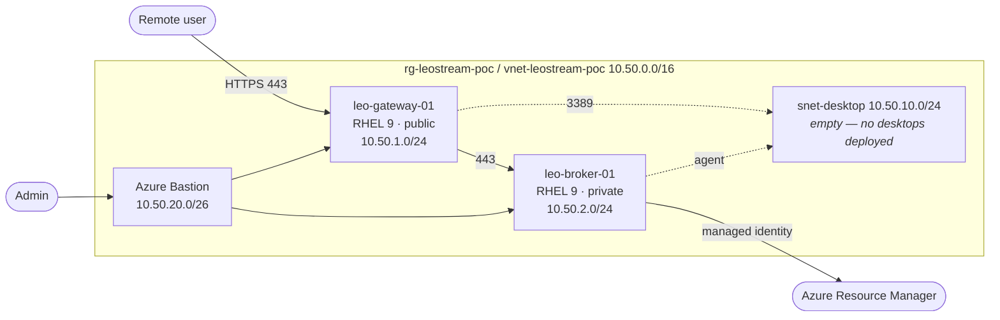

# Leostream Platform 26 on Azure — Proof of Concept

PowerShell automation that stands up a complete, security-minded
**Leostream Platform 26** proof of concept on Microsoft Azure: a private
Connection Broker, a separate internet-facing Leostream Gateway, a private
Windows 11 desktop and Azure Bastion for administration.

> **No secrets, installers or licence material live in this repository.**
> Passwords are prompted for, Linux access is SSH-key only, the Broker uses a
> system-assigned managed identity, and Leostream media is downloaded at run
> time from URLs you supply.

---

## Contents

- [Architecture at a glance](#architecture-at-a-glance)
- [Repository layout](#repository-layout)
- [Prerequisites](#prerequisites)
- [Quick start](#quick-start)
- [Configuration](#configuration)
- [Deployment](#deployment)
- [Leostream configuration](#leostream-configuration)
- [Validation](#validation)
- [Troubleshooting](#troubleshooting)
- [Teardown](#teardown)
- [Cost](#cost)
- [Security notes](#security-notes)
- [Licence](#licence)

---

## Architecture at a glance



| Component | Resource | OS | Exposure |
|---|---|---|---|
| Connection Broker | `leo-broker-01` | RHEL 9 | Private only, system-assigned managed identity |
| Gateway | `leo-gateway-01` | RHEL 9 | Public TCP/443 only |
| Administration | Azure Bastion | — | Azure portal / native client |

| Subnet | CIDR | Contents |
|---|---|---|
| `snet-gateway` | `10.50.1.0/24` | `leo-gateway-01` |
| `snet-infrastructure` | `10.50.2.0/24` | `leo-broker-01` |
| `snet-desktop` | `10.50.10.0/24` | *empty — reserved for desktops* |
| `AzureBastionSubnet` | `10.50.20.0/26` | Azure Bastion |

Broker and Gateway are **always separate virtual machines** — the deployment and
validation scripts both enforce this.

### No desktops are deployed

This PoC deploys the Leostream **control plane only**: Broker, Gateway and
Bastion. The desktop subnet and `nsg-desktop` are still created — with RDP
already permitted from the Gateway and Bastion subnets — so you can add desktops
later without re-addressing the network.

Because there is no desktop, the following cannot be exercised out of the box:

- end-to-end user session through the Gateway to a desktop
- Leostream Agent registration, pools, policies and assignment
- the Broker's managed identity starting/stopping a desktop VM

The managed identity and its role assignment are still deployed and verified
(`Test-LeostreamPoC.ps1` confirms the identity exists and the role is scoped
correctly). To exercise the full brokering path, add a Windows VM to
`snet-desktop` and run
`./Install-LeostreamAgent.ps1 -VMName <name> -InstallerUri <uri>`.

Full detail: [docs/architecture.md](docs/architecture.md).

---

## Repository layout

```
leostream-azure-poc/
├── README.md
├── LICENSE
├── .gitignore
├── config/
│   └── poc.config.psd1              # single source of truth, no secrets
├── docs/
│   ├── architecture.md              # design, topology, traffic flows
│   ├── installation.md              # step-by-step deployment guide
│   └── validation.md                # acceptance checks and negative tests
└── scripts/
    ├── Deploy-LeostreamPoC.ps1          # RG, VNet, subnets, NSGs, Bastion, 2 VMs
    ├── Configure-LeostreamAzureRBAC.ps1 # managed identity + role assignment
    ├── Install-LeostreamBroker.ps1      # Platform 26 on leo-broker-01
    ├── Install-LeostreamGateway.ps1     # Gateway on leo-gateway-01
    ├── Install-LeostreamAgent.ps1       # Agent on a desktop you add later (optional)
    ├── Test-LeostreamPoC.ps1            # validation
    └── Remove-LeostreamPoC.ps1          # teardown
```

---

## Prerequisites

| Requirement | Minimum |
|---|---|
| PowerShell | Windows PowerShell **5.1** or PowerShell **7.4+** (7.x recommended) |
| Az modules | `Az.Accounts`, `Az.Resources`, `Az.Network`, `Az.Compute` (11.0+) |
| Azure permissions | Contributor **and** User Access Administrator (or Owner) on the subscription |
| Azure quota | ~10 vCPUs of the `Dsv5` family in the target region |
| SSH key pair | For the RHEL 9 VMs |
| Leostream | Evaluation licence plus HTTPS download URLs for the Platform, Gateway and Agent installers |

```powershell
Install-Module Az -Scope CurrentUser -Repository PSGallery -Force
ssh-keygen -t ed25519 -C "leostream-poc" -f $HOME\.ssh\leostream_poc
```

---

## Quick start

```powershell
git clone https://github.com/mehmetkadriumay/leostream-azure-poc.git
cd leostream-azure-poc

# 1. Edit config/poc.config.psd1 - at minimum set AllowedClientCidrs and SshPublicKeyPath
code config/poc.config.psd1

# 2. Sign in
Connect-AzAccount
Set-AzContext -Subscription '<subscription-id>'

cd scripts

# 3. Preview, then deploy the infrastructure
./Deploy-LeostreamPoC.ps1 -WhatIf
./Deploy-LeostreamPoC.ps1 -Verbose

# 4. Grant the Broker managed identity its Azure role
./Configure-LeostreamAzureRBAC.ps1

# 5. Install the Leostream software (URLs come from your Leostream portal)
./Install-LeostreamBroker.ps1  -InstallerUri 'https://<portal>/<platform-26-installer>'
./Install-LeostreamGateway.ps1 -InstallerUri 'https://<portal>/<gateway-installer>'

# 6. Validate
./Test-LeostreamPoC.ps1
```

---

## Configuration

Everything is centralised in [`config/poc.config.psd1`](config/poc.config.psd1).

| Key | Default | Change this when |
|---|---|---|
| `Azure.SubscriptionId` | `''` (current context) | Targeting a specific subscription |
| `Azure.Location` | `westeurope` | Different region |
| `Azure.ResourceGroupName` | `rg-leostream-poc` | Naming standards differ |
| `Network.AddressSpace` | `10.50.0.0/16` | Overlaps existing networks |
| `Network.Subnets.*` | see table above | Address plan differs |
| `AllowedClientCidrs` | `0.0.0.0/0` | **Always** — narrow to your egress IPs |
| `Bastion.Enabled` | `$true` | You already have a jump host |
| `VirtualMachines.*.Size` | `D4s_v5` / `D2s_v5` | Cost or performance tuning |
| `VirtualMachines.*.SecurityType` | `Standard` | You want secure boot and vTPM on the RHEL VMs |
| `Admin.SshPublicKeyPath` | `~/.ssh/id_rsa.pub` | Your key lives elsewhere |
| `Rbac.RoleDefinitionName` | `Virtual Machine Contributor` | Broker needs broader or narrower rights |
| `Rbac.Scope` | `ResourceGroup` | Broker must manage VMs subscription-wide |

The deployment script prints a warning if `AllowedClientCidrs` still contains
`0.0.0.0/0`.

### What is never stored here

* Linux credentials — password auth is disabled, SSH public key only
* Leostream licence keys and serial numbers — passed as a `SecureString` or
  entered in the Broker UI
* Leostream RPMs and MSIs — downloaded at run time from URLs you supply
* Azure credentials and service-principal secrets — the Broker uses a
  system-assigned managed identity

---

## Deployment

### 1. Infrastructure — `Deploy-LeostreamPoC.ps1`

Creates, idempotently:

1. Resource group `rg-leostream-poc` with PoC tags
2. Three NSGs (`nsg-gateway`, `nsg-infrastructure`, `nsg-desktop`) with
   least-privilege rules and an explicit deny at priority 4000
3. VNet `vnet-leostream-poc` with the four subnets (`snet-desktop` is created
   but left empty)
4. Azure Bastion (10–20 minutes; skip with `-SkipBastion`)
5. `leo-broker-01` and `leo-gateway-01`

```powershell
./Deploy-LeostreamPoC.ps1 -WhatIf          # preview
./Deploy-LeostreamPoC.ps1 -SkipBastion     # cheaper first pass
./Deploy-LeostreamPoC.ps1 -Verbose
```

Re-running skips anything that already exists.

### 2. RBAC — `Configure-LeostreamAzureRBAC.ps1`

Confirms the Broker's system-assigned managed identity and assigns
**Virtual Machine Contributor** at resource group scope, retrying while Entra ID
replicates. It then prints the subscription, tenant and resource group values
you need in the Broker UI.

```powershell
./Configure-LeostreamAzureRBAC.ps1
./Configure-LeostreamAzureRBAC.ps1 -Scope Subscription -RoleDefinitionName 'Contributor'
```

### 3–4. Software installation

The installers run through the **Azure RunCommand extension**, so the private
VMs never need inbound connectivity from the internet.

| Script | Does |
|---|---|
| `Install-LeostreamBroker.ps1` | Updates RHEL 9, installs prerequisites, opens 443/tcp, sets hostname, runs the Platform 26 installer, optionally applies a licence key |
| `Install-LeostreamGateway.ps1` | Configures firewalld (443 public, SSH VNet-only), applies gateway kernel settings, runs the Gateway installer, records the Broker address |
| `Install-LeostreamAgent.ps1` *(optional)* | For a desktop you add yourself: enables RDP restricted to the gateway/infra/Bastion subnets, installs the Agent MSI silently with `BROKER_ADDRESS`. Requires `-VMName`. |

Full walkthrough: [docs/installation.md](docs/installation.md).

---

## Leostream configuration

The Broker has no public IP and there is no desktop to browse from, so reach its
UI with an SSH tunnel through the Gateway:

```powershell
ssh -i $HOME\.ssh\leostream_poc -L 8443:10.50.2.10:443 leoadmin@<gateway-public-ip>
# browse to https://localhost:8443/
```

Bastion native-client tunnelling also works, but **requires the Standard SKU** —
set `Bastion.Sku = 'Standard'` in `poc.config.psd1` before deploying:

```powershell
az network bastion tunnel --name bastion-leostream-poc --resource-group rg-leostream-poc `
    --target-resource-id <leo-broker-01-resource-id> --resource-port 443 --port 8443
```

Then:

1. Sign in as `admin` / `leo` and **change the password immediately**.
2. *System > License* — apply your evaluation licence.
3. *Setup > Centers > Add Center > Azure* — authentication **Managed identity**,
   with the subscription, tenant and resource group printed by the RBAC script.
4. *Setup > Gateways* — register `leo-gateway-01` (public address for clients,
   `10.50.1.10` privately).
5. *Configuration > Protocol Plans* — RDP via the Gateway.

Steps 1–5 are all this PoC exercises. Pools, policies and assignments need at
least one desktop: add a Windows VM to `snet-desktop`, run
`./Install-LeostreamAgent.ps1 -VMName <name> -InstallerUri <uri>`, then continue
with *Configuration > Pools*, *Policies* and *Assignments*.

---

## Validation

```powershell
./Test-LeostreamPoC.ps1                    # full validation
./Test-LeostreamPoC.ps1 -SkipRemoteChecks  # Azure control plane only
```

Checks the resource group, VNet and all four subnet prefixes, NSG attachment and
the Gateway HTTPS rule, that Broker and Gateway are separate VMs, that both VMs
are running, that only the Gateway is internet-facing, that the Broker has a
managed identity with a role assignment, that Bastion exists, and that the
Gateway and Broker respond. Any desktops you have added to `snet-desktop` are
inventoried and checked for public IPs. Exits `1` on any failure.

Manual end-to-end and negative tests: [docs/validation.md](docs/validation.md).

---

## Troubleshooting

| Symptom | Likely cause | Fix |
|---|---|---|
| `SSH public key not found at ...` | `Admin.SshPublicKeyPath` is wrong | Generate a key or correct the path in `poc.config.psd1` |
| `New-AzVM: ... SkuNotAvailable` | VM size unavailable in the region | Change `VirtualMachines.*.Size` or `Azure.Location` |
| `OperationNotAllowed ... quota` | Insufficient vCPU quota | Request a quota increase or use smaller sizes |
| Bastion creation fails | `AzureBastionSubnet` wrong name or smaller than `/26` | Keep the configured name and prefix |
| `New-AzRoleAssignment` fails repeatedly | No User Access Administrator rights, or replication lag | Get the rights; the script already retries for ~2 minutes |
| `Invoke-AzVMRunCommand` times out | VM agent not ready | Wait a few minutes after VM creation and retry |
| Installer download fails inside the VM | URL expired, needs auth, or is not HTTPS | Use a fresh pre-signed HTTPS URL |
| Gateway page unreachable from your browser | Your IP not in `AllowedClientCidrs` | Add it, re-run `Deploy-LeostreamPoC.ps1` to update the NSG |
| Certificate warning on the Gateway | Self-signed certificate | Install a trusted certificate before any real use |
| No desktops offered to any user | Working as designed — this PoC deploys none | Add a VM to `snet-desktop` and run `Install-LeostreamAgent.ps1 -VMName <name>` |
| Desktop you added is not offered | Agent not registered, or no policy assigned | Check the Agent service, then the Broker pool/policy/assignment |
| Broker cannot see Azure VMs | Role assignment missing or wrong scope | Re-run `Configure-LeostreamAzureRBAC.ps1` |
| Cannot reach the Broker UI | Working as designed — it is private | Use the SSH tunnel through the Gateway above |

Useful diagnostics (replace the resource group if you changed
`Azure.ResourceGroupName`):

```powershell
$rg = (Import-PowerShellDataFile ./config/poc.config.psd1).Azure.ResourceGroupName

# Gateway service and firewall
Invoke-AzVMRunCommand -ResourceGroupName $rg -VMName leo-gateway-01 `
    -CommandId RunShellScript -ScriptString 'systemctl status leostream-gateway --no-pager; firewall-cmd --list-all'

# Broker service
Invoke-AzVMRunCommand -ResourceGroupName $rg -VMName leo-broker-01 `
    -CommandId RunShellScript -ScriptString 'systemctl status leostream --no-pager; ss -lntp | grep :443'

# Effective NSG rules
Get-AzEffectiveNetworkSecurityGroup -ResourceGroupName $rg -NetworkInterfaceName nic-leo-gateway-01
```

---

## Teardown

```powershell
./Remove-LeostreamPoC.ps1                      # delete everything, with confirmation
./Remove-LeostreamPoC.ps1 -KeepResourceGroup   # delete resources, keep the RG
./Remove-LeostreamPoC.ps1 -Force               # no prompt (use carefully)
```

The script refuses to touch a resource group that is not tagged
`project=leostream-poc` unless `-Force` is given, and it removes the Broker
identity's role assignments so none are orphaned.

Release your Leostream licence seats afterwards.

---

## Cost

Rough guide for `westeurope`, pay-as-you-go, running continuously:

| Resource | Approximate monthly cost |
|---|---|
| `leo-broker-01` (D4s_v5) | high |
| `leo-gateway-01` (D2s_v5) | medium |
| Azure Bastion Basic | medium, billed hourly plus egress |
| Managed disks, public IPs | low |

Deploying no desktops removes the single largest line item from a typical
Leostream PoC — add them back only for the period you need to test brokering.

Keep a PoC cheap by deploying with `-SkipBastion`, using `Standard_D2s_v5` for
all VMs, deallocating VMs when idle, and running `Remove-LeostreamPoC.ps1` as
soon as the evaluation is finished. Always confirm current prices with the
[Azure pricing calculator](https://azure.microsoft.com/pricing/calculator/).

---

## Security notes

This is a **proof of concept**. Before anything resembling production use:

* Narrow `AllowedClientCidrs` — never leave `0.0.0.0/0`.
* Install a trusted TLS certificate on the Gateway.
* Change the default Broker credentials immediately and enable MFA.
* Join any desktops you add to Entra ID / Active Directory and apply baseline
  policies. Keep them off public IPs — `nsg-desktop` already denies inbound from
  the internet.
* Add diagnostic settings, Microsoft Defender for Cloud and Azure Monitor.
* Replace the single Broker and Gateway with an HA pair behind a load balancer.
* Store any operational secrets in Azure Key Vault.
* Review the role granted to the Broker identity and reduce it to the minimum
  your Leostream features actually require.

---

## Licence

[MIT](LICENSE). Leostream Platform, Leostream Gateway and Leostream Agent are
products of Leostream Corporation and are licensed separately; this repository
contains none of their software, licence keys or serial numbers.
