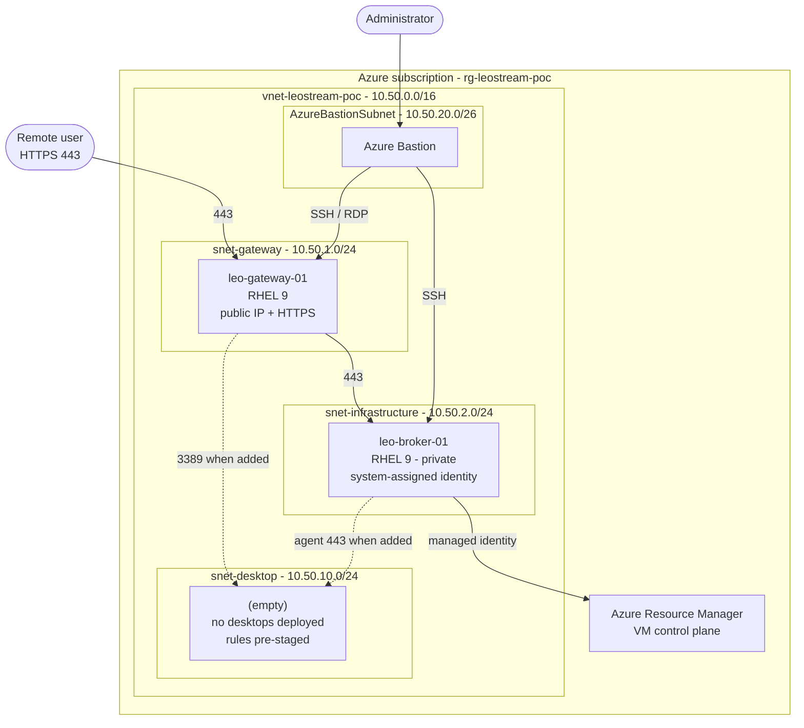

# Architecture

This proof of concept deploys a minimal but realistic Leostream Platform 26
environment on Microsoft Azure. It is designed for evaluation and demonstration,
not for production use.

## Design principles

| Principle | How it is applied |
|---|---|
| Separation of roles | The Connection Broker and the Leostream Gateway run on **separate virtual machines**. |
| Minimal exposure | Only `leo-gateway-01` has a public IP address, and only TCP/443 is published. |
| Private management | The Broker is reachable only through Azure Bastion or from inside the VNet. Any desktops added later inherit the same posture. |
| No long-lived secrets | The Broker uses a **system-assigned managed identity** for Azure integration; the Linux VMs use SSH keys only. |
| Repeatability | All infrastructure is described in `config/poc.config.psd1` and created by idempotent PowerShell scripts. |

## Topology



Dotted edges are pre-authorised by NSG rules but carry no traffic today: this
PoC deploys the Leostream control plane only.

## Address plan

| Subnet | Name | CIDR | Usable | Purpose |
|---|---|---|---|---|
| Gateway | `snet-gateway` | `10.50.1.0/24` | 251 | Internet-facing Leostream Gateway |
| Infrastructure | `snet-infrastructure` | `10.50.2.0/24` | 251 | Connection Broker and future supporting services |
| Desktop | `snet-desktop` | `10.50.10.0/24` | 251 | Managed desktops — **created empty**, reserved for desktops added later |
| Bastion | `AzureBastionSubnet` | `10.50.20.0/26` | 59 | Azure Bastion (name and `/26` minimum are mandated by Azure) |

VNet address space: `10.50.0.0/16`, which leaves room to add subnets (for
example a gateway subnet for ExpressRoute or a dedicated database subnet)
without re-addressing.

## Virtual machines

| VM | Role | OS | Default size | IP | Public | Identity |
|---|---|---|---|---|---|---|
| `leo-broker-01` | Connection Broker (Leostream Platform 26) | RHEL 9 | `Standard_D4s_v5` | `10.50.2.10` | No | System-assigned managed identity |
| `leo-gateway-01` | Leostream Gateway | RHEL 9 | `Standard_D2s_v5` | `10.50.1.10` | Yes (TCP/443) | None |

Static private IPs are used so the Gateway and Agent configurations are stable
across restarts. Both VMs use `SecurityType = 'Standard'`; set `'TrustedLaunch'`
in `poc.config.psd1` to enable secure boot and vTPM on the Gen2 RHEL images.

### Desktops are intentionally out of scope

This PoC deploys **no desktops**. The scope is the Leostream control plane —
Broker, Gateway, Bastion, networking and the Azure identity integration.

The consequence is that brokering itself is not demonstrated end to end: there is
no Agent to register, no pool or policy to assign, no user session to establish,
and no VM for the Broker's managed identity to start or stop. The identity and
its role assignment are still created and validated, but only their *existence
and scope* are verified, not their effect.

To close that gap, create a Windows VM in `snet-desktop` and run:

```powershell
./Install-LeostreamAgent.ps1 -VMName <name> -InstallerUri 'https://<portal>/LeostreamAgent.msi'
```

`nsg-desktop` already permits RDP from `snet-gateway` and `AzureBastionSubnet`
and Agent traffic from `snet-infrastructure`, so no network changes are needed.
Note that Windows 11 marketplace images are Gen2 and require **Trusted Launch**
(secure boot and vTPM) when you create them.

> **Broker and Gateway must stay separate.** `Deploy-LeostreamPoC.ps1` and
> `Test-LeostreamPoC.ps1` both fail if the two VM names are ever made identical.

## Traffic flows

| # | Source | Destination | Port | Purpose |
|---|---|---|---|---|
| 1 | Internet (`AllowedClientCidrs`) | `leo-gateway-01` | TCP 443 | User login page and tunnelled display protocol |
| 2 | `snet-gateway` | `leo-broker-01` | TCP 443 | Gateway to Broker web services |
| 3 | `snet-gateway` | `snet-desktop` | TCP 3389 | RDP proxied to the desktop — *pre-authorised, unused* |
| 4 | `snet-infrastructure` | `snet-desktop` | TCP 443 / 8080 | Broker to Leostream Agent — *pre-authorised, unused* |
| 5 | `snet-desktop` | `leo-broker-01` | TCP 443 | Agent check-in and status — *pre-authorised, unused* |
| 6 | `AzureBastionSubnet` | all VM subnets | TCP 22 / 3389 | Administrative access |
| 7 | `leo-broker-01` | Azure Resource Manager | TCP 443 | VM discovery and power control via managed identity |

Every NSG ends with an explicit `Deny-All-Inbound` rule at priority 4000, after
the specific allow rules.

## Identity model

The Broker authenticates to Azure with its **system-assigned managed identity**
rather than a service principal with a client secret:

1. `Deploy-LeostreamPoC.ps1` creates `leo-broker-01` with `-IdentityType SystemAssigned`.
2. `Configure-LeostreamAzureRBAC.ps1` assigns **Virtual Machine Contributor**
   (configurable) at resource group scope to that identity.
3. In the Broker UI you create an Azure center that authenticates with the
   instance metadata endpoint — no secret is ever entered or stored.

Role assignments are removed again by `Remove-LeostreamPoC.ps1`, so no orphaned
assignments remain after teardown.

## What this PoC deliberately omits

* High availability (single Broker, single Gateway, no load balancer)
* An external or replicated database
* Managed desktops of any kind, and therefore Active Directory / Entra ID domain
  join, pools, policies and assignments
* Trusted TLS certificates (the Gateway starts with a self-signed certificate)
* Backup, patch management, monitoring and cost governance
* Private Link / Private DNS for the Azure control-plane calls

See [installation.md](installation.md) for deployment and
[validation.md](validation.md) for the acceptance checks.
