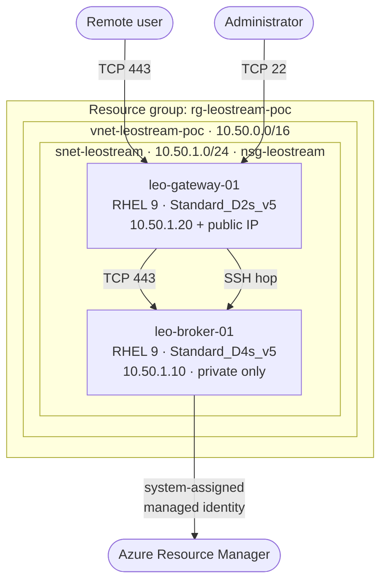

# Architecture

## Design goal

The smallest topology that still demonstrates Leostream Platform 26 running on
Azure with a real managed-identity integration. Two virtual machines, one subnet,
one network security group. Every piece that is not needed to prove the concept
has been left out.

## Topology

## Resources

| Resource | Name | Notes |
|---|---|---|
| Resource group | `rg-leostream-poc` | Tagged `project=leostream-poc`; the teardown script keys off this tag |
| Virtual network | `vnet-leostream-poc` | `10.50.0.0/16` |
| Subnet | `snet-leostream` | `10.50.1.0/24`, holds both VMs |
| Network security group | `nsg-leostream` | Attached to the subnet |
| Public IP | `pip-leo-gateway-01` | Standard SKU, static, Gateway only |
| Virtual machine | `leo-broker-01` | RHEL 9, private, system-assigned managed identity |
| Virtual machine | `leo-gateway-01` | RHEL 9, public IP |

Broker and Gateway are separate VMs by design. `Deploy-LeostreamPoC.ps1` throws
if the two names in config are identical, and `Test-LeostreamPoC.ps1` checks the
same thing after the fact.

### Why the Broker is the larger VM

Leostream's floor for a Connection Broker is 2 vCPU, 8 GB RAM and 20 GB of disk,
on RHEL 9.6 or later — or Rocky Linux or AlmaLinux. RHEL 8 and CentOS Stream 9
are not supported, and a Broker on RHEL 8 cannot be upgraded in place.

In a cloud the hypervisor reserves part of the instance, so a size with
*exactly* 8 GB trips the Broker's own health checks. `Standard_D4s_v5` (4 vCPU,
16 GB) is the smallest comfortable choice; `Standard_D2s_v5` is exactly 8 GB and
would warn. The Gateway has no such requirement and stays on `D2s_v5`.

`Test-LeostreamPoC.ps1` reports a `Sizing` warning if the Broker is shrunk below
this.

## Network security

`nsg-leostream` carries exactly two explicit rules:

| Priority | Name | Direction | Source | Destination | Port |
|---|---|---|---|---|---|
| 100 | `Allow-HTTPS-Inbound` | Inbound | `AllowedClientCidrs` | `10.50.1.0/24` | 443 |
| 110 | `Allow-SSH-Inbound` | Inbound | `AllowedClientCidrs` | `10.50.1.0/24` | 22 |

Leostream also lists inbound 80, which serves the HTTP-to-HTTPS redirect on the
administrator interface and lets certbot answer an ACME http-01 challenge when
replacing the self-signed certificate. Neither applies here — the admin UI is
reached over an SSH tunnel on 443 — so the rule is opt-in: set `Ports.Http = 80`
in `poc.config.psd1` and redeploy to add `Allow-HTTP-Inbound` at priority 120.

Nothing else is required, because Azure's default rules already provide what is
needed:

| Priority | Default rule | Effect here |
|---|---|---|
| 65000 | `AllowVnetInBound` | Gateway reaches the Broker on 443 and 22 without an explicit rule |
| 65001 | `AllowAzureLoadBalancerInBound` | Health probes |
| 65500 | `DenyAllInBound` | Everything else from the internet is dropped |

The Broker has no public IP, so the two inbound rules only ever match traffic
aimed at the Gateway.

> **Note:** these rules are only as safe as `AllowedClientCidrs`. The shipped
> default of `0.0.0.0/0` exposes both HTTPS *and* SSH to the entire internet.
> Narrow it to your own egress IP before deploying.

## Traffic flows

| Flow | Path | Port |
|---|---|---|
| User → Gateway | Internet → public IP | 443 |
| Gateway → Broker | Inside the VNet | 443 |
| Administrator → Gateway | Internet → public IP | 22 |
| Administrator → Broker | SSH jump through the Gateway | 22 |
| Administrator → Broker UI | SSH local forward through the Gateway | 443 → localhost:8443 |
| Broker → Azure | Outbound HTTPS to Azure Resource Manager | 443 |
| Both VMs → Azure control plane | RunCommand via the guest agent, outbound only | 443 |
| Broker → internet | Outbound only, via the NAT gateway | 443 |
| Gateway → internet | Outbound via its own instance-level public IP | 443 |

### Outbound internet

Azure [retired default outbound access](https://learn.microsoft.com/azure/virtual-network/ip-services/default-outbound-access)
on 30 September 2025, so a VM with no public IP, NAT gateway or load-balancer
outbound rule has no route to the internet at all.

`leo-gateway-01` is unaffected: an instance-level public IP provides outbound as
well as inbound. `leo-broker-01` is deliberately private, so it would otherwise
be unable to reach the RHEL, EPEL and Leostream download endpoints its
installation depends on — surfacing as repository metadata timeouts rather than
an obvious connectivity error.

`natgw-leostream` is attached to `snet-leostream` to supply that path. A NAT
gateway initiates connections outward only; nothing on the internet can use it
to reach either VM, so the Broker stays private. Both VMs share it, though the
Gateway continues to prefer its own public IP.

Set `Network.NatGatewayEnabled = $false` if the subnet already has outbound
access by another route, such as a firewall or user-defined route.

## Identity

`leo-broker-01` is created with a system-assigned managed identity
(`New-AzVMConfig -IdentityType SystemAssigned`).

That identity is deliberately left **with no role assignment**. A role would let
the Broker discover, start and stop desktop VMs through an Azure center, and this
PoC deploys no desktops — so the permission would grant power over the
subscription that nothing uses. Creating the identity but not assigning a role
keeps the groundwork in place at zero privilege.

No service principal is created by the base deployment and no secret is stored
anywhere — in this repository, in the VM, or in the Broker configuration.

### Giving the Broker real Azure rights

Once desktops exist, the Broker needs an **Azure Center** and therefore a
credential with rights over the resource group. There are two routes, and they
fail in very different places:

| Route | Directory work | Azure RBAC work | Fails where |
|---|---|---|---|
| Managed identity | none | role assignment on the VM identity | The *only* step, so a Contributor is blocked outright |
| Entra ID application | create app, service principal, secret | role assignment on the service principal | The last step, after the reusable artefacts already exist |

`Configure-LeostreamAzureCenter.ps1` implements the second route for exactly
that reason. Creating an application registration is a Microsoft Entra
operation governed by directory settings, not by Azure RBAC, so it generally
succeeds for an ordinary user. The script then attempts the role assignment and,
if that returns `AuthorizationFailed`, prints a single `New-AzRoleAssignment`
command to forward to an Owner or User Access Administrator rather than
unwinding the work already done.

Trade-offs to be aware of:

* An application secret is bearer material with an expiry. A managed identity
  has neither, which is why it remains the better choice when the permission to
  assign roles is available.
* The secret is surfaced once on the console and never persisted by these
  scripts. Rotation is `-RotateSecret`.
* The application lives in the tenant, not the resource group, so teardown
  needs `Remove-LeostreamPoC.ps1 -RemoveAzureCenterApp`.
* `Contributor` on the resource group is the default because it is what
  Leostream documents; a custom role limited to read/start/stop/create/delete on
  `Microsoft.Compute/virtualMachines` is tighter and works for most features.

## Deliberate omissions

| Not deployed | Why | Consequence |
|---|---|---|
| Azure Bastion | Roughly doubles the cost of the PoC and takes 10–20 minutes to provision | Administration is over SSH to the Gateway's public IP |
| Separate subnets per tier | Two VMs do not need network segmentation to prove the concept | Gateway and Broker are not isolated from each other |
| Desktop VMs | The largest cost item, and not needed to prove the control plane | Pools, policies and end-to-end sessions are not exercised |
| A role assignment for the Broker identity | Nothing to manage without desktops, and granting roles needs User Access Administrator, which a Contributor cannot self-serve | No Azure center by default; the identity exists at zero privilege. `Configure-LeostreamAzureCenter.ps1` adds one on demand |
| Explicit deny rules | Azure already denies inbound by default at 65500 | None — the effective behaviour is identical |
| Trusted Launch / vTPM | Extra configuration surface for no PoC benefit | VMs use the standard security type |

## What a production design would change

* Gateway and Broker in separate subnets, each with its own NSG.
* Azure Bastion or a VPN gateway for administration; no public SSH.
* Broker and Gateway deployed as HA pairs behind a load balancer.
* A trusted TLS certificate and a real DNS name on the Gateway.
* Desktops in a dedicated subnet with no outbound internet access.
* Diagnostic settings, Defender for Cloud and Azure Monitor across the board.
* A narrower custom role for the Broker identity than Virtual Machine Contributor.
