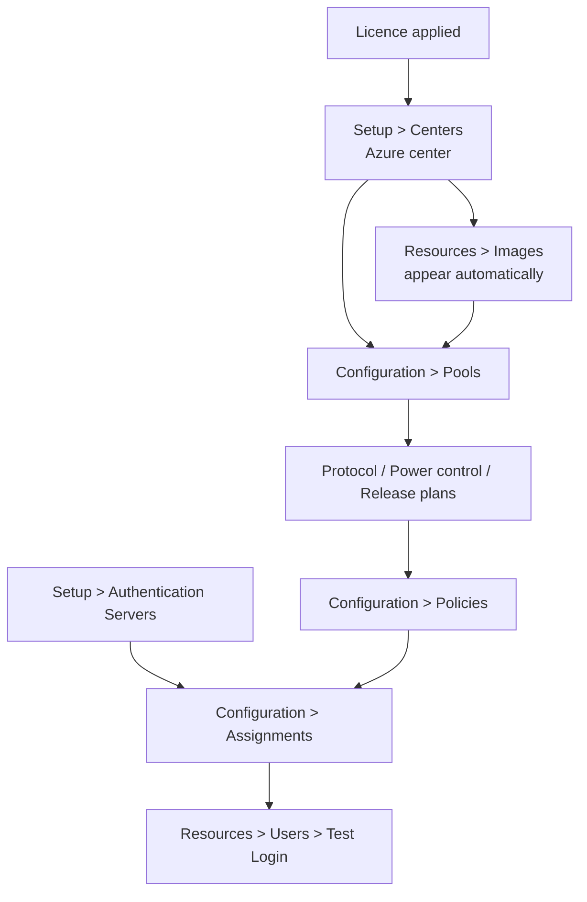

# Configuring Leostream for Azure

What to do in the Broker UI *after* the infrastructure exists. The deployment
scripts stop at a licensed Broker and a working Gateway; everything below is
configuration you click through at `https://localhost:8443/` over the SSH tunnel
described in [installation.md](installation.md#reaching-the-broker-console).

This follows Leostream's *Using the Leostream Platform to Manage VDI in
Microsoft Azure Clouds* guide, with the parts that are specific to this PoC's
network layout called out.

## Order of operations



Nothing further down works until the step above it is in place. A pool with no
center is empty; a policy with no pool offers nothing; an assignment with no
authentication server has no users to match.

---

## 1. Authentication server

Leostream matches users against an authentication server before it applies any
policy. Go to *Setup > Authentication Servers > Add Authentication Server*,
choose **Active Directory**, and give it the domain, the hostname or IP, and the
port (389, or 636 with *Encrypt connection ... (LDAPS)* ticked).

The search account needs only **read** access to user records — not domain
administrator. Leave *Match login name against this field* at `sAMAccountName`.

> **Microsoft Entra ID is not an Active Directory server.** You cannot point this
> form at Entra ID, however tempting the name is. Entra ID is a SAML identity
> provider to Leostream and is configured elsewhere — see Leostream's *Using
> Microsoft Entra ID and Azure MFA with the Leostream Platform*. Trying to use
> the Active Directory form against Entra ID fails with LDAP bind errors.

This PoC deploys no domain controller. Without one you can still sign in with the
local `admin` account and exercise centers, pools and provisioning; you just
cannot test end-user policy assignment.

---

## 2. Azure center

*Setup > Centers > Add Center > Microsoft Azure*. A center is what makes Azure
VMs visible to the Broker.

| Field | Value for this PoC |
|---|---|
| Type | Microsoft Azure |
| Name | anything, e.g. `azure-westeurope` |
| Authentication | **Application Key** (see below) |
| Region | the region in `Azure.Location` — `westeurope` by default |
| Subscription ID | printed by `Configure-LeostreamAzureCenter.ps1` |
| Directory (tenant) ID | printed by the same script |
| Application (client) ID | printed by the same script |
| Secret Access Key | the client secret, shown **once** |
| Inventory refresh interval | 5–10 minutes is fine for a PoC |
| Use a Leostream Gateway to communicate with this Center | leave **unchecked** |

### Application key or managed identity

Both are valid when the Broker runs in Azure. The practical difference is who
has to approve what:

* **Application key** — the default here. Creating the app, its service
  principal and the secret needs no Azure RBAC at all. Only the final role
  assignment is elevated, and it is one command you can delegate. Run
  `./Configure-LeostreamAzureCenter.ps1`.
* **Managed identity** — no secret to rotate, and it also *supplies the region*,
  so the Region drop-down disappears. But the Broker's identity still needs a
  role assignment, which a Contributor cannot create. `leo-broker-01` is
  deployed with a system-assigned identity ready for this, so you can switch
  later if someone grants it `Contributor`.

**One center per region.** The center only ever sees VMs, images and resource
groups in its own region. Add a second center to manage a second region.

### A resource group must exist in that region

Leostream can only provision into resource groups it has inventoried, and it
inventories only those in the center's region. `rg-leostream-poc` is created in
`Azure.Location`, so this is already satisfied — but if you change the region in
the center without moving the resource group, the *Resource group* drop-down in
the provisioning form comes up empty.

### If the center cannot connect

The Broker reaches the Azure API directly, over the NAT gateway. It needs
outbound 443 to:

```
login.microsoftonline.com
management.azure.com
<anything>.blob.core.windows.net
```

These resolve to different addresses on every call, so an IP allow-list will not
hold. `./Test-LeostreamPoC.ps1` probes the first two from inside the Broker and
also checks that the TLS handshake completes, which catches an intercepting
proxy that passes a plain TCP test.

If your network genuinely cannot allow that egress, the Leostream Gateway can
forward the Azure API on the Broker's behalf — tick *Use a Leostream Gateway to
communicate with this Center* and enable Azure API forwarding on the Gateway.
That is not needed in this PoC, where `natgw-leostream` provides the egress.

Once the center saves, Azure VMs appear under *Resources > Desktops* and images
under *Resources > Images*.

---

## 3. Preparing a desktop image

Only needed if you want Leostream to *provision* new desktops rather than manage
existing ones.

* Install the **Leostream Agent** on the master VM and point it at the Broker.
  In this PoC the desktop shares a subnet with the Broker, so use the private
  address `10.50.1.10`. Use a public address only when the two are genuinely on
  different networks.
* **Do not join the master to a domain.** Leostream only joins machines that are
  currently in a Workgroup, so a domain-joined image can never be domain-joined
  again by the Broker.
* **Run sysprep** before capturing.
* Capture a **managed image**. Leostream's guide is explicit that an image
  *version* shared into a gallery cannot be used for provisioning; the
  provisioning form does offer an Azure Compute Gallery option, so if you use a
  gallery, verify it inventories before you build a pool around it.

Verify the agent in both directions before going further: the *Test* button on
the Leostream Agent control panel proves agent → Broker, and the *Status* link
on *Resources > Desktops* proves Broker → agent. Domain join and idle-time
actions need both.

---

## 4. Pools

*Configuration > Pools > Create Pool*. A pool is just a group of desktops, and
it must be defined so that **newly provisioned machines fall into it
automatically** — otherwise provisioning creates VMs that the pool cannot see
and it provisions again, forever.

The reliable trick is to match on name:

1. *Desktop attribute* → **Name**
2. *Conditional* → **begins with**
3. *Text value* → the prefix you will use, e.g. `leo-desk-`

Then make sure the *Virtual machine name* in the provisioning section starts
with that same prefix.

---

## 5. Provisioning

In *Edit Pool > Provisioning*, tick **Provisioning enabled**.

> Provisioning is licence-gated. If you do not see this section at all, your
> licence does not include it — that is a sales question, not a configuration
> one.

**Limits.** Provisioning starts when *unassigned* desktops (total minus
assigned) fall below the lower bound, and stops when *total* reaches the upper
bound. The Broker evaluates this when the pool is saved, when a user is assigned
a desktop, and whenever a `pool_stats` job runs. For a PoC, 1 and 2 are plenty.

**Parameters that matter in this network:**

| Field | Value | Why |
|---|---|---|
| Virtual machine name | `leo-desk-{SEQUENCE}` | must match the pool's name prefix |
| Resource group | `rg-leostream-poc` | must be in the center's region |
| Deploy from | Image | your managed image |
| Instance size | e.g. `Standard_D2s_v5` | subject to your quota |
| Virtual network / subnet | `vnet-leostream-poc` / `snet-leostream` | the only subnet here |
| Create and associate new public IP | **unchecked** | keeps desktops private; clients reach them through the Gateway |
| Security group | `nsg-leostream` | |
| Mark newly provisioned desktops as deletable | ticked | lets a release plan delete them, which is how you stop paying |

Leaving the public IP box unchecked is the whole point of running a Gateway: the
desktop stays unreachable from the internet and the Gateway brokers the
connection.

**Ephemeral OS disks** are offered for stateless pools and are cheaper, but
powering a VM off *deletes* it, and Leostream does not support the Reboot or
Power-off-and-Start actions on them. Do not combine ephemeral disks with a power
control plan that suspends or powers off idle desktops.

**If provisioning silently stops**, the Broker has disabled it after a
configuration error. The usual causes are a vCPU quota ceiling or an instance
size not offered in that region. Fix the parameters, then re-tick *Provisioning
enabled*. Transient Azure API errors do *not* disable provisioning — the Broker
retries those.

### Domain join

In *Domain Join*, tick *Join machine to a domain* and pick the domain. The
domain must already exist as an authentication server (step 1).

If you also tick *Set desktop hostname to virtual machine name*, the VM name has
to be a legal Windows computer name: **15 characters or fewer**, letters, digits
and `! @ # $ % ^ & ' ) ( . - _ { } ~`. A `{SEQUENCE}` tag counts toward that
limit once expanded — `leo-desk-{SEQUENCE}` is fine, a long prefix is not.

For non-persistent pools, also tick *When virtual machine is permanently
deleted, also remove it from the domain* to avoid accumulating stale AD
computer objects.

---

## 6. Plans

Three pool-based plans control the connection. Defaults exist for all three, and
for a PoC the defaults are often enough.

* **Protocol plan** (*Configuration > Protocol Plans*) — which display protocol
  to use. Set a protocol's *Priority* to `1` to select it. The default uses RDP.
  Which protocols are available depends on your licence.
* **Power control plan** — what to do, and after how long, on disconnect,
  logout, release or idle. Set *Wait* to zero to act immediately. Idle and
  disconnect detection requires a running Leostream Agent on the desktop.
* **Release plan** — how long a desktop stays assigned to a user. The default
  keeps the assignment until logout. To delete the VM when it is released —
  worth doing in a cost-sensitive PoC — the release plan option works only if
  the desktop also has *Allow this desktop to be deleted from disk* set, which
  is what *Mark newly provisioned desktops as deletable* does for you.

A worked example: to force a logout an hour after a user disconnects, set
*Forced Logout* to `after 1 hour` in *When User Disconnects from Desktop*. The
logout then triggers the logout section, which releases the desktop.

---

## 7. Policy and assignment

*Configuration > Policies > Create Policy*, then *Pool Assignments > Add Pool
Assignments*:

1. *Number of desktops to offer* — `1` for a PoC.
2. *Pool* — the pool from step 4.
3. *Plans* — the three plans from step 6.

> **A desktop without a Leostream Agent is not offered by default.** If you are
> testing against a VM you have not put an agent on, set *Offer running
> desktops* to *Yes, regardless of Leostream Agent status*, or the policy will
> appear to match and still show the user nothing.

Then map users to the policy: *Configuration > Assignments*, edit the row for
your authentication server, and select a *Group* (matched against the user's
`memberOf`), a *User Role* and a *User Policy*.

If you changed AD group membership after signing in, sign out of the Broker and
back in — group data is cached per session.

---

## 8. Test before you blame anything

*Resources > Users > Test Login*. Enter a username, pick the domain, and run it.
The Broker reports which authentication server matched, which role and policy it
resolved, and which desktops the policy would offer — without the user ever
logging in.

Leostream asks you to complete a login test before contacting support, and it is
genuinely the fastest way to tell "the user cannot connect" apart from "the
policy offers nothing".

For the infrastructure side of validation, see [validation.md](validation.md)
and `./Test-LeostreamPoC.ps1`.
